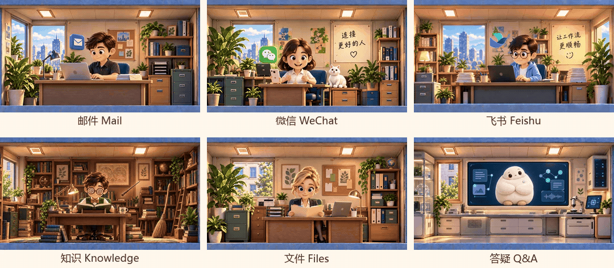
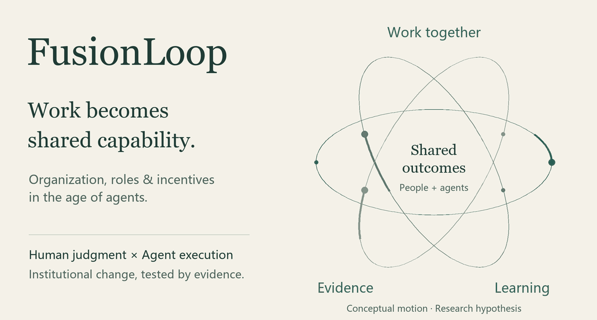
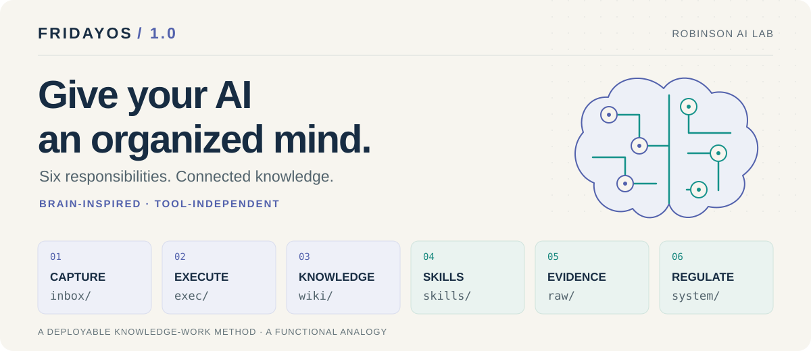

# Designing work for the age of AI.

I'm **Owen Teng**, working across HR leadership, product building and organizational learning—exploring how people and agents work together, and how experience becomes reusable capability.

[简体中文](README.zh-CN.md) · [Website](https://tengxinyang.cn) · [Robinson AI Lab](https://github.com/Robinson-AI-Lab)

## Companest · 伴境

**Work, with companions.** Rooms, animation and six assistants make everyday collaboration with AI more approachable. The Windows mail preview brings organizing work, editable replies and follow-through into a public showcase with private source; more workflows unlock progressively.

[Enter Companest →](projects/companest/README.md) · [Watch the six-companion greeting](projects/companest/docs/media/companions-greeting-grid.mp4)

### 30 seconds of real interaction: enter, edit, save

[Download the HD MP4](https://github.com/Owen-Teng/Owen-Teng/raw/refs/heads/main/projects/companest/docs/media/companest-real-mail-30s-redacted.mp4)

Enter the mail room from the little world, open a real matter, review its context and suggestions, edit the reply, and save the draft locally.

This 30-second recording keeps the real mouse clicks, character animation, interface transitions and save feedback. Names, company references and sender/recipient addresses are mosaicked.

*Edited real desktop footage with gaps shortened. Suggestions were generated during preparation; the clip reopens them and does not demonstrate first-generation speed. The draft was saved locally; no email was sent. The Chinese interface still shows Friday branding.*

## FusionLoop

<a href="https://github.com/Owen-Teng/fusionloop/blob/main/paper/README.md"><picture>
  <source media="(prefers-reduced-motion: reduce) and (max-width: 1100px)" srcset="assets/profile/fusionloop-motion-mobile.en.png">
  <source media="(prefers-reduced-motion: reduce)" srcset="assets/profile/fusionloop-motion.en.png">
  <source media="(max-width: 1100px)" srcset="assets/profile/fusionloop-motion-mobile.en.gif">
  
</picture></a>

**From shared delivery to capability an organization can reuse.** My research explores how human judgment and agent execution work around shared outcomes, then uses operating evidence to examine changes in roles, authority and incentives. The 37-page paper presents hypotheses that remain to be tested in real operation.

[Read the paper →](https://github.com/Owen-Teng/fusionloop/blob/main/paper/README.md) · [Core hypotheses](https://github.com/Owen-Teng/fusionloop/blob/main/idea.md) · [Role example](https://github.com/Owen-Teng/fusionloop/blob/main/examples/talent-supply.md)

## FridayOS 1.0

<a href="https://github.com/Robinson-AI-Lab/FridayOS1.0"><picture>
  <source media="(max-width: 1100px)" srcset="assets/profile/fridayos-six-brain-mobile.svg">
  
</picture></a>

**Give knowledge a structure your AI can work with.** I proposed the Six-Brain Method and developed it with Robinson AI Lab into an open-source personal knowledge management project: a local Markdown blueprint, an Obsidian example vault and bilingual guides. Maintained by Robinson AI Lab.

[Explore FridayOS 1.0 →](https://github.com/Robinson-AI-Lab/FridayOS1.0) · [The Six-Brain Method](https://github.com/Robinson-AI-Lab/FridayOS1.0/blob/main/docs/SIX-BRAIN.md) · [Get started](https://github.com/Robinson-AI-Lab/FridayOS1.0/blob/main/docs/DEPLOYMENT.md)

**Other open-source exploration:** [frago](https://github.com/Owen-Teng/frago) — an agent automation toolkit forked from [tsaijamey/frago](https://github.com/tsaijamey/frago).

## Writing & interviews

**[Bringing gamification into management](https://www.forbeschina.com/business/62996)**  
Forbes China · 2023 — Management, gamification and industry collaboration. In Chinese.

**[Designing an AI-HR strategy in the generative AI era](https://www.infoq.cn/article/qfi3ivzcfjehwjltkmoe)**  
InfoQ · 2024 — Adapted from my DTDS talk. In Chinese.

**[When the organization learns](https://github.com/Owen-Teng/fusionloop/blob/main/essays/organizational-learning.md)**  
Research note — How personal experience becomes knowledge another person can use.

## Background

HR Director at **Neusoft Smartgo** since March 2025; previously Head of Neusoft's Shanghai Branch of Group HR. Co-founder of **Robinson AI Lab**.

MS in Marketing, **Johns Hopkins University** (2017). Selected for [Forbes China's 2022 list of 100 Outstanding Young Overseas Returnees](https://www.forbeschina.com/business/62548), Growth Potential category.

More about my practice and research

- **AI × HR.** Led Neusoft's Apollo Innovation Lab, 2023–2025, bringing digital employees and workflow automation into practice and developing the team's product capabilities.
- **Products & learning.** Waffle Product Incubation Lead at Shanghai Xuanxiao Technology, 2023–2025; connecting enterprise learning needs, game mechanics, interaction design, development, and client delivery.
- **Community.** Founded AGSC under the Shanghai Multimedia Industry Association; served as Director and Chair during 2019–2025 and led the second through fifth GCA conferences.
- **Open questions.** What evidence justifies changing a role? Can another person use a method independently? How can spaces, roles, and feedback make human–agent collaboration easier to understand?

---

Counterexamples and attempts that did not work are welcome. [Join the research discussion →](https://github.com/Owen-Teng/fusionloop/issues)
