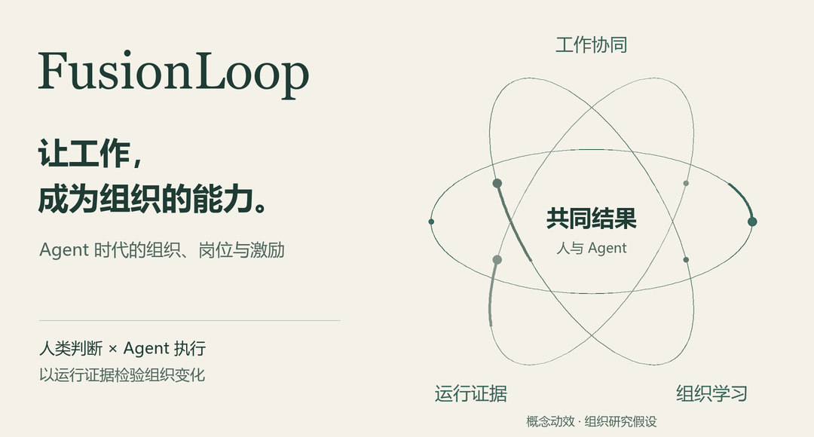
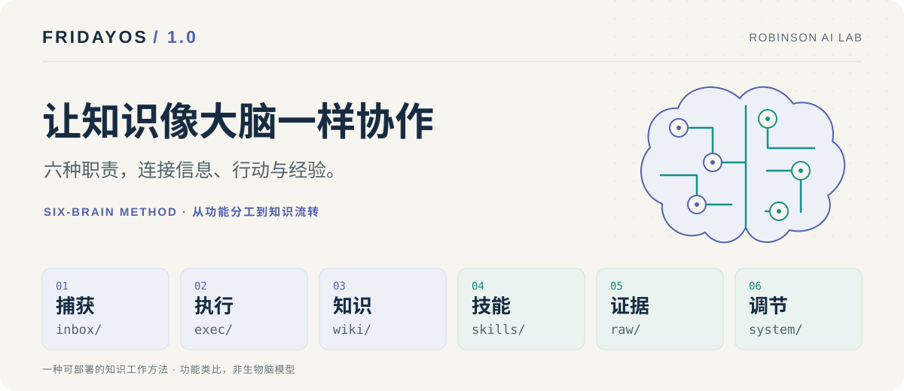

# 为 AI 时代重新设计工作。

我是 **滕新阳 Owen Teng**，从事人力资源管理、产品建设与组织学习，探索人和 Agent 如何共同完成工作，让经验成为可以复用的能力。

[English](README.md) · [个人网站](https://tengxinyang.cn) · [鲁滨逊实验室](https://github.com/Robinson-AI-Lab)

## 伴境 Companest

**让工作，有伙伴。** 用房间、动画和六位助理，让人与 AI 的日常协作更容易理解和参与。从事项整理、可编辑回复与持续跟进开始，Windows 邮件预览现已公开展示，源码私有，更多能力逐版解锁。

[走进伴境 →](projects/companest/README.zh-CN.md) · [观看高清演示](projects/companest/docs/media/companions-greeting-grid.mp4)

### 30 秒实机操作：从进入到保存回复

[下载高清实录 MP4](https://github.com/Owen-Teng/Owen-Teng/raw/refs/heads/main//projects/companest/docs/media/companest-real-mail-30s-redacted.mp4)

从小世界走进邮件房间，点开一件真实事项，看背景与建议，把回复改成自己的意思，再保存到本机。

这段 30 秒视频保留了实际鼠标点击、角色动画、界面切换和保存反馈；人名、公司名称及收发件邮箱已打码。

*实机操作剪辑，压缩了操作间隔；建议已在准备阶段生成，片中打开已有建议，不代表首次生成速度。本次只保存本地草稿，没有发送邮件。中文界面仍有 Friday 标识。*

## FusionLoop

<a href="https://github.com/Owen-Teng/fusionloop/blob/main/paper/README.md"><picture>
  <source media="(prefers-reduced-motion: reduce) and (max-width: 1100px)" srcset="assets/profile/fusionloop-motion-mobile.zh.png">
  <source media="(prefers-reduced-motion: reduce)" srcset="assets/profile/fusionloop-motion.zh.png">
  <source media="(max-width: 1100px)" srcset="assets/profile/fusionloop-motion-mobile.zh.gif">
  
</picture></a>

**从一次共同交付，到组织能够复用的能力。** 我的组织研究，探索人类判断与 Agent 执行如何围绕共享结果协作，再用运行证据检验岗位、权责与激励的变化。37 页论文提出研究假设，仍待真实运行检验。

[阅读论文 →](https://github.com/Owen-Teng/fusionloop/blob/main/paper/README.md) · [核心假设](https://github.com/Owen-Teng/fusionloop/blob/main/idea.zh-CN.md) · [岗位示例](https://github.com/Owen-Teng/fusionloop/blob/main/examples/talent-supply.zh-CN.md)

## FridayOS 1.0

<a href="https://github.com/Robinson-AI-Lab/FridayOS1.0"><picture>
  <source media="(max-width: 1100px)" srcset="assets/profile/fridayos-six-brain-mobile.zh-CN.svg">
  
</picture></a>

**让知识像大脑一样分工，让 AI 沿着你的知识持续工作。** 我提出六脑方法，与鲁滨逊实验室伙伴共同发展为开源的个人知识管理项目，提供本地 Markdown 蓝图、Obsidian 示例知识库与中英文教程。项目由鲁滨逊实验室维护。

[探索 FridayOS 1.0 →](https://github.com/Robinson-AI-Lab/FridayOS1.0/blob/main/README.zh-CN.md) · [六脑方法](https://github.com/Robinson-AI-Lab/FridayOS1.0/blob/main/docs/SIX-BRAIN.zh-CN.md) · [开始部署](https://github.com/Robinson-AI-Lab/FridayOS1.0/blob/main/docs/DEPLOYMENT.zh-CN.md)

**其他开源探索：** [frago](https://github.com/Owen-Teng/frago) — 用于研究 Agent 自动化工具链，Fork 自 [tsaijamey/frago](https://github.com/tsaijamey/frago)。

## 文章与人物专访

**[对话滕新阳：做本土游戏化的领航者](https://www.forbeschina.com/business/62996)**  
福布斯中国 · 2023 — 管理、游戏化与行业协作。

**[东软集团：生成式 AI 时代，如何布局 AI 人力资源战略？](https://www.infoq.cn/article/qfi3ivzcfjehwjltkmoe)**  
InfoQ · 2024 — 由我的 DTDS 演讲整理。

**[一个人学会以后，组织怎样也能学会？](https://github.com/Owen-Teng/fusionloop/blob/main/essays/organizational-learning.zh-CN.md)**  
研究短文 — 把个人经验转为其他人可以独立使用的知识与方法。

## 关于我

2025 年 3 月起任**东软智行人力资源总监**，曾任东软集团人力资源部上海分部部长。与伙伴共同发起**鲁滨逊实验室**。

**约翰斯·霍普金斯大学**市场营销理学硕士（2017）。入选 [2022 福布斯中国·青年海归菁英 100 人](https://www.forbeschina.com/business/62548)成长力榜。

展开实践经历与研究问题

- **AI × HR。** 2023–2025 年牵头东软阿波罗创新实验室，推动 HR 数字员工与流程自动化落地，并培养团队的产品设计能力。
- **产品与学习。** 2023–2025 年负责上海宣潇科技 Waffle 产品孵化，连接企业学习需求、游戏机制、交互设计、研发与客户交付。
- **社区合作。** 发起上海市多媒体行业协会游戏化专业委员会 AGSC，2019–2025 年任主任兼理事长，主导第二至第五届 GCA 大会。
- **持续追问。** 什么证据足以支持岗位变化？另一位使用者能否独立使用一套方法？空间、角色和反馈怎样让人与 Agent 的协作更容易理解？

---

欢迎提出反例、难懂的段落，以及没有成功的实际尝试。[参与研究讨论 →](https://github.com/Owen-Teng/fusionloop/issues)
